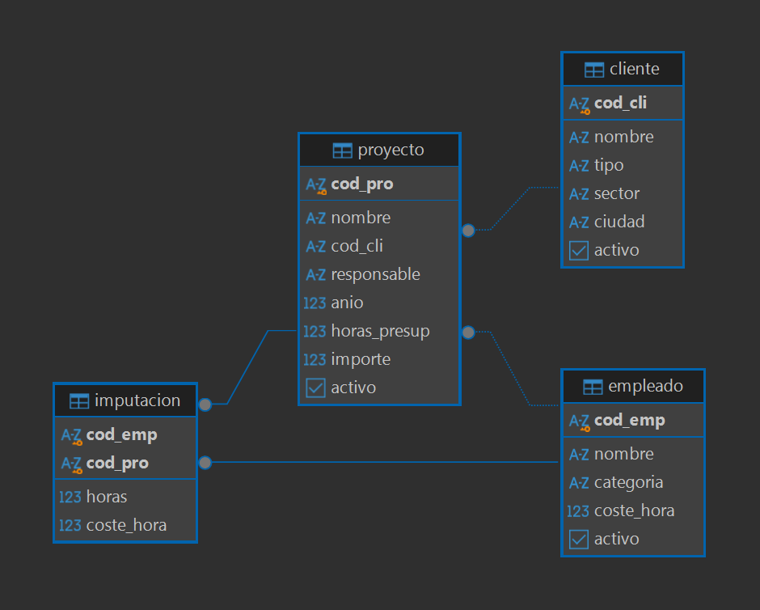

# Control de proyectos y rentabilidad de una consultora · SQL (PostgreSQL)

Base de datos relacional para que una consultora pequeña responda a las preguntas que se hace cualquier dirección financiera o de operaciones:

- ¿Qué proyectos consumen más horas de las vendidas?
- ¿Cuáles pierden dinero?
- ¿Qué sectores y clientes aportan más negocio?
- ¿Cómo evoluciona el coste del personal de un año a otro?

El proyecto cubre el ciclo completo: **diseño del modelo relacional, restricciones de integridad, carga de datos y consultas de análisis** con SQL estándar sobre PostgreSQL.

> Proyecto realizado en la asignatura de Bases de Datos del Máster de Formación Permanente en Inteligencia Artificial y Big Data Analytics (Universitat Politècnica de València, curso 2026-27). Los datos son **sintéticos**: empresas y personas inventadas.

---

## Resultados destacados

Sobre los 14 proyectos ya cerrados:

| Indicador | Valor |
|---|---|
| Importe contratado | 129.100 € |
| Coste de personal | 75.616,50 € |
| Margen global sobre coste de personal | **41,4 %** |
| Proyectos que superaron las horas presupuestadas | **5 de 14** (35,7 %) |
| Horas reales frente a presupuestadas | 2.074 h frente a 1.890 h (**+9,7 %**) |

Hallazgos:

1. **Un proyecto con pérdidas.** El *Cuadro de mando municipal* (P0009) consumió 350 horas frente a las 220 vendidas (+59 %) y cerró con un margen de **−9,9 %** (−1.520 €). Se vendió a 70 €/h, pero el coste medio del equipo fue de 48,34 €/h, con 150 horas de una socia, el perfil más caro.
2. **La desviación de horas no siempre hunde el margen.** P0011 se pasó 65 horas y aun así dejó un 41,7 % de margen: se vendió a 80 €/h y el coste medio del equipo fue de 36,69 €/h, gracias a un reparto con más horas de perfiles junior y becario.
3. **El coste medio por hora depende de quién trabaja, no solo de los salarios.** En 2024 subió a 41,12 €/h (33,97 € en 2023) sobre todo porque los socios pasaron del 5,4 % al 24,9 % de las horas imputadas; las subidas salariales anuales fueron mucho menores.
4. **Energía es el sector con más negocio** (48.600 € en 3 proyectos), seguido de Comercio e Industria.

El detalle de las 7 consultas está en [`docs/resultados.md`](docs/resultados.md).

---

## Modelo de datos



| Tabla | Contenido | Claves |
|---|---|---|
| `cliente` | Organizaciones para las que se trabaja: tipo, sector, ciudad, si sigue activo | PK `cod_cli` · UNIQUE `nombre` |
| `empleado` | Personal: categoría, coste por hora **actual**, si sigue en la empresa | PK `cod_emp` |
| `proyecto` | Encargos: cliente, responsable, año, horas presupuestadas, importe, si está en curso | PK `cod_pro` · FK → `cliente` · FK → `empleado` (responsable) |
| `imputacion` | Horas de cada empleado en cada proyecto, al coste por hora **aplicado** ese año | PK (`cod_emp`, `cod_pro`) · FK → `empleado` · FK → `proyecto` |

### Decisiones de diseño

- **Coste histórico frente a coste actual.** El coste por hora se guarda en `empleado` (el de hoy) y también en `imputacion` (el que tenía la persona cuando trabajó en ese proyecto). Así, una subida salarial no altera los márgenes de proyectos pasados. Es el mismo principio que copiar el precio en cada línea de una factura.
- **Listas cerradas con `CHECK`** para tipo de cliente, sector y categoría. Se evitan variantes como «educacion» frente a «Educación», que romperían cualquier agrupación.
- **`NUMERIC` para importes y costes**, no `REAL`: es un tipo exacto, imprescindible con dinero.
- **`BOOLEAN` para el estado** de clientes, empleados y proyectos.
- **Reglas de borrado explícitas.** No se puede borrar un cliente con proyectos ni un empleado con horas o proyectos a su cargo (`RESTRICT`). Al borrar un proyecto se borran sus imputaciones (`CASCADE`).
- **Restricciones con nombre** (`pk_`, `fk_`, `uni_`, `ri1_`…), para que un error indique qué regla se ha incumplido.

### Datos

87 filas: 12 clientes, 10 empleados, 20 proyectos (de 2023 a 2026) y 45 imputaciones. Se han construido para recoger situaciones reales que las consultas deben detectar: proyectos desviados, uno con pérdidas, un cliente inactivo, otro sin proyectos, un empleado que dejó la empresa siendo responsable de proyectos y una incorporación reciente sin horas.

---

## Consultas

| N.º | Pregunta de negocio | Técnicas |
|---|---|---|
| 1 | Clientes sin ciudad registrada | `IS NULL` |
| 2 | Proyectos e importe contratado por sector | `JOIN` · `GROUP BY` |
| 3 | Proyectos que superan sus horas presupuestadas | `JOIN` · `GROUP BY` · `HAVING` |
| 4 | Margen de los proyectos cerrados | `JOIN` · `GROUP BY` · expresiones calculadas |
| 5 | Empleados sin horas imputadas | `LEFT JOIN` · `IS NULL` |
| 6 | Proyectos cuyo responsable ya no está en la empresa | `JOIN` de tres tablas |
| 7 | Horas, coste y coste medio ponderado por año | `JOIN` · `GROUP BY` · media ponderada |

Cada consulta está comentada en [`sql/03_consultas.sql`](sql/03_consultas.sql): enunciado, razonamiento y solución.

---

## Cómo ejecutarlo

### Opción 1: Docker (recomendada)

Requiere Docker Desktop.

```bash
git clone https://github.com/fernando-chust/consultora-sql.git
cd consultora-sql
docker compose up -d
```

La primera vez, el contenedor ejecuta automáticamente `01_crear.sql` y `02_poblar.sql`. Después, conecta con cualquier cliente SQL (DBeaver, pgAdmin, psql):

| Parámetro | Valor |
|---|---|
| Servidor | `localhost` |
| Puerto | `5433` |
| Base de datos | `consultora` |
| Usuario / contraseña | `consultora` / `consultora` |

Y ejecuta `sql/03_consultas.sql`. Para borrarlo todo: `docker compose down -v`.

### Opción 2: un PostgreSQL existente

Ejecuta los scripts en orden: `01_crear.sql`, `02_poblar.sql` y `03_consultas.sql`. Todo se crea dentro del esquema `consultora`, así que no interfiere con otras tablas. Los dos primeros se pueden volver a ejecutar sin errores: borran y recrean su contenido.

---

## Estructura

```
consultora-sql/
├── README.md
├── LICENSE
├── docker-compose.yml
├── sql/
│   ├── 01_crear.sql       esquema, tablas y restricciones
│   ├── 02_poblar.sql      datos sintéticos (87 filas)
│   └── 03_consultas.sql   7 consultas comentadas
└── docs/
    ├── diagrama_er.png    diagrama entidad-relación
    └── resultados.md      resultado de cada consulta
```

---

## Limitaciones y siguientes pasos

- **Simplificaciones del modelo.** Las horas se registran acumuladas por empleado y proyecto, no por fecha, y cada proyecto se asigna a su año de inicio. El siguiente paso natural es imputar por fecha, lo que permitiría seguimiento mensual.
- **Reglas de negocio no impuestas por la base de datos.** Por ejemplo, que un cliente inactivo no tenga proyectos en curso. Se respetan en los datos, pero hacerlas obligatorias exigiría triggers.
- **Margen sobre coste de personal.** No incluye gastos generales ni otros costes directos.
- **Siguiente fase prevista:** una capa de análisis sobre esta base de datos (pandas o Power BI) con cuadros de mando de rentabilidad por cliente, sector y año.

---

## Autor

**Fernando Chust Piles** · Ingeniero industrial (UPV), Máster en Estrategia Empresarial. Experiencia en dirección de ingeniería, operaciones y consultoría; actualmente cursa el Máster en IA y Big Data Analytics de la UPV.

[LinkedIn](https://www.linkedin.com/in/ia-y-datos-para-decidir/)

## Licencia

[MIT](LICENSE).
